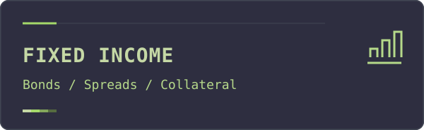
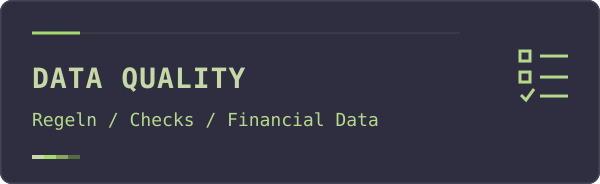
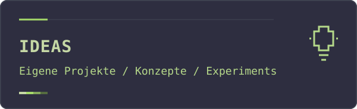
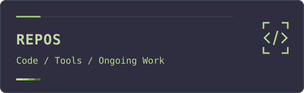

## About / Über mich

Mein Hintergrund liegt in Fixed Income Capital Markets. Hier geht es um Finanzdaten, Data Quality, eigene Tools und kleine Experimente.

  
  

  
  

## Featured repositories

| Repository | Kurzbeschreibung |
| :--- | :--- |
| [bond-spreads-monitor](https://github.com/pzdenis/bond-spreads-monitor) | Projekt rund um Anleihen und Spreads. |
| [bond-analytics-workbench](https://github.com/pzdenis/bond-analytics-workbench) | Arbeitsbereich für Fixed-Income-Analysen. |
| [data_quality_fixed_income](https://github.com/pzdenis/data_quality_fixed_income) | Data Quality im Fixed-Income-Kontext. |
| [eurex-gc-auswertung](https://github.com/pzdenis/eurex-gc-auswertung) | Python-CLI zur Auswertung von Eurex GC Pooling Basket-Dateien. |

## Eigene Ideen / Own ideas

Offene Richtungen: kleine Analytics-Werkzeuge und nachvollziehbare Datenchecks. Daneben ist Platz für Linux-Ideen und technische Experimente — Gedanken und Versuche, die noch wachsen dürfen.

## Tech / Tools

`R` · `Python` · `SQL` · `Bash` · `Linux` · `Git`
